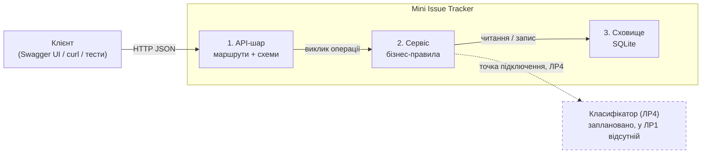
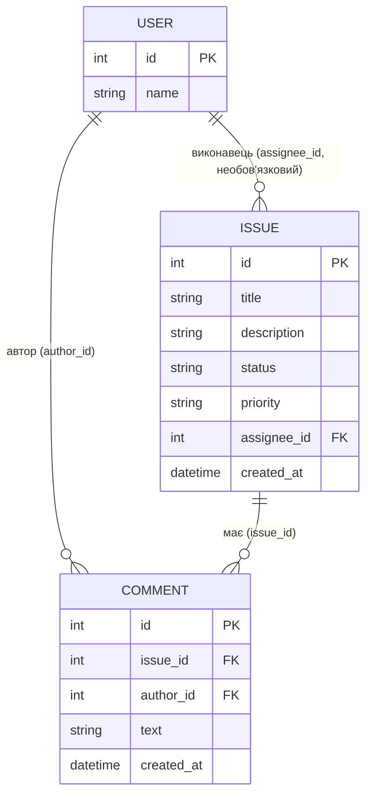

# Архітектура: Mini Issue Tracker

Документ описує мінімальну архітектуру для ЛР2 (реалізація) і ЛР3 (тестування). Бізнес-правила, поля й помилки тут не повторюються: їх єдине джерело істини це [requirements.md](requirements.md). Тут визначено лише, з яких частин складається система і яка частина за що відповідає.

## 1. Компоненти

Система складається з трьох компонентів. Клієнт (Swagger UI, curl або автоматичні тести) не є частиною системи.

| Компонент | Відповідальність | Чого не робить |
|---|---|---|
| **1. API-шар** (маршрути і схеми) | Приймає HTTP-запити; схеми перевіряють форму входу (типи, межі довжини, допустимі значення, невідомі поля, null); маршрути перетворюють результат операції на HTTP-відповідь і код | Не містить бізнес-правил (переходи статусів, заморожування закритої заявки) |
| **2. Сервіс** | Реалізує бізнес-правила: існування заявки, переходи статусів, заморожування закритої заявки, часткове редагування й атомарність, фільтрація, впорядкування, перевірка посилань на користувача | Не знає про HTTP і про формат відповідей; не пише SQL |
| **3. Сховище** (SQLite) | Збереження заявок, коментарів і довідника користувачів; ключі й обмеження цілісності; транзакції | Не містить бізнес-правил |

Залежності йдуть лише в один бік: API-шар → сервіс → сховище. Сервіс не залежить від маршрутів і HTTP, сховище не знає про сервіс. Схеми є спільним модулем даних: їх використовують і маршрути (для відповідей), і сервіс (для валідації тіла запиту у визначений момент, див. «Наслідок для реалізації»).

## 2. Де реалізується кожне правило

| Правило (джерело в requirements.md) | Компонент |
|---|---|
| Типи, межі довжини, регістр `priority`, значення `status`, нормалізація пробілів, null лише для `assignee_id`, недозволені поля при створенні (наприклад, `assignee_id`, D-05) | Схеми. Для PATCH схему викликає сервіс після перевірки існування й стану заявки (див. нижче) |
| Заявка існує; ідентифікатор не додатне ціле → «не знайдено» (D-10) | Сервіс |
| Матриця переходів, повтор статусу, заборона редагування закритої заявки (D-01, D-07) | Сервіс |
| Порожній PATCH (D-08), недозволене поле в PATCH, порядок перевірок | Сервіс (викликає схему валідації тіла запиту) |
| Атомарність часткового редагування | Сервіс + сховище: усі зміни застосовуються в одній транзакції |
| Фільтри status і priority, AND (FR-02, D-09), порядок `created_at`, `id` (D-03) | Сервіс (правила), сховище (запит) |
| Посилання на заявку й користувачів 1 або 2 (зв'язки) | Сервіс перевіряє, сховище забезпечує зовнішніми ключами |
| Відповідність категорій результатів (не знайдено, конфлікт, валідація) HTTP-кодам | API-шар; конкретні коди визначає [api-contract.md](api-contract.md) |
| Збереження між запусками (FR-07) | Сховище |

### Наслідок для реалізації: порядок перевірок

У requirements.md порядок такий: спочатку «не знайдено», потім «конфлікт зі станом», потім «валідація» (розділи PATCH і каталог результатів). Багато веб-фреймворків автоматично перевіряють тіло запиту раніше, ніж викликають обробник, і тоді валідація випередила б решту. Тому маршрут для `PATCH /issues/{id}` передає в сервіс необроблене тіло, а сервіс спершу знаходить заявку й перевіряє її стан, і лише потім викликає схему валідації тіла. Це обмеження слід врахувати в ЛР2.

## 3. Точка підключення класифікатора (ЛР4)

Для FR-08 (рекомендація категорії, пріоритету й підсумку) у ЛР4 потрібен окремий компонент. У ЛР1–ЛР3 його немає, виклику моделі немає. Точка підключення заплановано так:

- Сервіс залежить від простого інтерфейсу «класифікатор», який у ЛР4 отримає реальну реалізацію (виклик LLM). У ЛР1–ЛР3 цього інтерфейсу ніхто не викликає.
- Класифікатор лише повертає рекомендацію. Він не має доступу до сховища і не змінює заявку автоматично (FR-08); зміна полів лишається звичайним редагуванням користувачем.
- Недоступність класифікатора не впливає на звичайний облік заявок (NFR-06).

## 4. Модель сутностей

Три сутності. Поля, типи, межі й обов'язковість визначені в розділі «Модель даних» файлу requirements.md. Тут показані лише ключі й зв'язки.

Видалення сутностей не передбачене, тому правил каскадного видалення немає. Користувачі 1 (Agent A) і 2 (Agent B) створюються при ініціалізації бази й через API не змінюються.

## 5. Планована структура коду

Початковий набір файлів для ЛР2 (методичка орієнтує на 8–15 основних файлів до кінця практикуму, тому набір буде доповнюватися). Назви можна змінити, але відповідальності зберігаються.

| Файл | Компонент | Призначення |
|---|---|---|
| `app/main.py` | API-шар | створення застосунку, підключення маршрутів, ініціалізація бази |
| `app/routes.py` | API-шар | 9 маршрутів, перетворення результатів на HTTP-відповіді |
| `app/schemas.py` | API-шар | схеми входу й виходу, валідація форми |
| `app/service.py` | Сервіс | бізнес-правила з розділів «Життєвий цикл», «PATCH», «Каталог результатів» |
| `app/database.py` | Сховище | підключення до SQLite, створення схеми, транзакції |
| `tests/` | поза системою | тести ЛР3, окрема тестова база (NFR-03) |

## 6. Архітектурні рішення (ADR)

### ADR-01. SQLite і локальний запуск

**Статус:** прийнято, 29.10.2026.

**Контекст.** FR-07 вимагає зберігання даних між перезапусками в SQLite. Система призначена для локальної роботи з синтетичними даними й не розміщується публічно (межі обсягу). Обсяг даних малий (орієнтир NFR-01: до 100 заявок). Запуск має бути простим для будь-кого, хто склонував репозиторій (NFR-04).

**Варіанти.**

| Варіант | Плюс | Мінус |
|---|---|---|
| A. SQLite (один файл) | не потребує окремого сервера; є в стандартній бібліотеці Python; підтримує транзакції й зовнішні ключі; тестова база створюється одним рядком | не розрахована на багато одночасних записів |
| B. Серверна СУБД (наприклад, PostgreSQL) | масштабується, багато користувачів | потребує окремого сервера (встановлення або Docker; Docker не входить до обсягу), ускладнює запуск (NFR-04) |
| C. Файли JSON | найпростіше | немає транзакцій, тож атомарність PATCH довелося б писати вручну; немає запитів для фільтрації й порядку |

**Обране рішення.** Варіант A. SQLite зберігає всі три сутності в одному файлі, схема створюється автоматично під час першого запуску. Тестова база окрема (тимчасова або в пам'яті, NFR-03).

**Причина.** Вимога FR-07 називає SQLite прямо. Він також дає транзакції, потрібні для атомарності часткового редагування (requirements.md, розділ PATCH), і зовнішні ключі для зв'язків, при цьому не ускладнює локальний запуск.

**Наслідок або обмеження.**
- Система розрахована на одного або кількох користувачів у локальному середовищі, але не на високе навантаження чи публічне розміщення.
- Бізнес-правила не залежать від SQLite: SQL знає лише компонент «Сховище», тому заміна СУБД вимагала б змін тільки в ньому.
- Шлях до файлу бази береться з налаштувань, а не з коду, щоб тести могли підставити окрему базу.
- Підтримка зовнішніх ключів у SQLite вмикається окремо для кожного з'єднання (`PRAGMA foreign_keys = ON`); це потрібно зробити в ЛР2, щоб зв'язки з requirements.md («Зв'язки між сутностями») забезпечувала база.

### ADR-02. AI-компонент окремо від бізнес-логіки

**Статус:** прийнято, 29.10.2026.

**Контекст.** У ЛР4 система має рекомендувати категорію, пріоритет і короткий підсумок заявки (FR-08). Рекомендація не повинна змінювати заявку автоматично. Звичайний облік заявок має працювати, коли мовна модель недоступна (NFR-06). Секрети, зокрема ключ до моделі, не зберігаються в репозиторії (NFR-05).

**Варіанти.**

| Варіант | Плюс | Мінус |
|---|---|---|
| A. Виклик моделі всередині сервісу під час створення або редагування заявки; результат записується автоматично | менше коду, «розумна» поведінка без дій користувача | недоступність моделі ламає створення заявок; модель змінює дані без людини, що суперечить FR-08; тести залежать від мережі й вартості викликів |
| B. Окремий компонент-класифікатор за простим інтерфейсом; сервіс викликає його лише на явний запит і лише повертає рекомендацію | звичайний облік не залежить від моделі; рішення про застосування приймає людина; у тестах класифікатор легко замінити заглушкою | потрібен окремий інтерфейс і окрема операція в API (ЛР4) |
| C. Фоновий процес, що періодично оновлює заявки | автоматично | змінює дані без людини; складніший запуск і тестування, поза обсягом |

**Обране рішення.** Варіант B. Класифікатор є окремим компонентом за інтерфейсом, який сервіс може викликати (точка підключення в architecture.md, розділ 3). Він не має доступу до сховища й не змінює заявки; результат повертається користувачеві як рекомендація. У ЛР1–ЛР3 його немає.

**Причина.** Це єдиний варіант, що одночасно виконує FR-08 («не змінює заявку автоматично») і NFR-06 («облік працює без LLM»). Він також дає змогу тестувати бізнес-логіку без мережі.

**Наслідок або обмеження.**
- Рекомендація не застосовується автоматично: користувач сам вирішує, чи змінювати поля заявки звичайним редагуванням.
- Для ЛР4 знадобиться окрема операція в API-контракті й окремі правила помилок (недоступність моделі) без впливу на решту операцій.
- Ключ доступу до моделі передаватиметься через змінну середовища, а не зберігатиметься в репозиторії.
